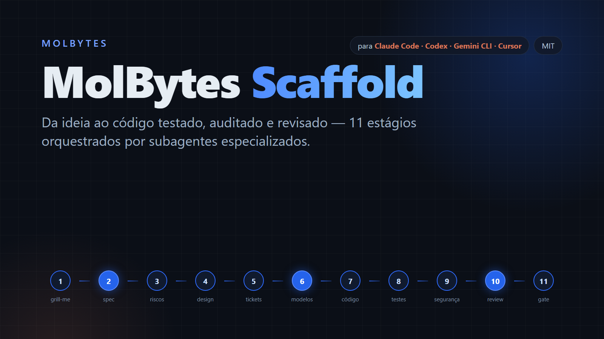

# MolBytes.Scaffold

**English** · [Português (Brasil)](README.pt-BR.md)



> By [MolBytes](https://www.molbytes.io) · created by Roberto Molina · [project page](https://www.molbytes.io/en/projetos/molbytes-scaffold)


A skill for [Claude Code](https://claude.com/claude-code), Codex, Gemini CLI
and Cursor that takes a software project from idea to tested, audited and
reviewed code, in 11 stages.

A main session acts as the **orchestrator**: it talks to you, hands each stage
to a specialized subagent running at the right model tier (light, medium or
strong; in Claude Code, haiku, sonnet or opus), checks the result and commits.
It never writes production code itself.

> **Language:** the skill's instructions, its in-pipeline commands
> (`continuar`, `aprovado`), its flags and the files it creates are in
> Brazilian Portuguese. You can describe your project in English.

## Pipeline

| # | Stage | Subagent | Output | Pauses for you |
|---|-------|----------|--------|----------------|
| 1 | grill-me | main session | `.project/qa.json` | conversation |
| 2 | spec + threat model | `scaffold-architect` | `.project/spec.md` | **approve spec** |
| 3 | risks, tech debt, security requirements | `scaffold-architect` | `.project/risks.yaml` | — |
| 4 | design | `scaffold-designer` | `.project/design/` | — |
| 5 | tickets | `scaffold-planner` | `.project/tickets.yaml` | — |
| 6 | model routing and waves | `scaffold-router` + `scripts/ondas.py` | `.project/agent-map.json` | **approve plan and cost** |
| 7 | parallel implementation in waves | `scaffold-implementer` | code | — |
| 8 | test plan → run → fix failures | `scaffold-tester` + `scaffold-implementer` | `.project/plano-de-teste.yaml` + tests | if a fix fails twice |
| 9 | security: audit → triage → fix → verify | `scaffold-security` + `scaffold-implementer` | `.project/security/` | medium findings |
| 10 | code review | `scaffold-reviewer` | `.project/code-review-report.md` | **decide on fixes** |
| 11 | final tests + rescan + gate | `scaffold-tester` + `scaffold-security` | `.project/pipeline-report.md` | if blocked |

## Highlights

- **Resumable:** `state.md` + git are the source of truth. At the pause
  points, `/clear` and `/molbytes:molbytes-scaffold continuar` (the same
  command works in a new session); after `/compact`, just `continuar`.
- **Extensible:** an extension skill adds rules per stack, domain or
  compliance without changing the pipeline; the contract is in
  `references/extensoes.md`.
- **Changing an existing system:** the skill looks for the system's
  documentation (inside the project or elsewhere) and updates it along with
  the code; without documentation, it only changes the system. Small changes
  cost less: risks only for what changes, and design is skipped when there is
  no new screen.
- **Documents outside the project, if you want:** spec, design and reports
  live in `.project/` or in a separate folder with its own git, so the
  client's project stays clean. See
  [INSTALL.md](INSTALL.md#where-the-documents-live).
- **Parallelism without conflicts:** tickets in the same wave never touch the
  same files; an `INFRA-000` ticket sets up structure, tests and dependencies
  before anything else. Waves come from a script (`scripts/ondas.py`), not
  from the model: it checks dependencies, file conflicts and missing or
  invented tickets.
- **Model routing per ticket:** payments, auth, offline sync and concurrency
  go to the strong tier; config and trivial CRUD to the light tier; the rest
  to medium. Each platform maps the tier to one of its own models. When tests
  fail, it retries on the same model and then moves up one tier.
- **Security at both ends:** threat model and testable requirements before
  the code; gitleaks, semgrep and trivy (via Docker) + an OWASP review after.
  Every fix starts with a test that reproduces the failure and is verified by
  another agent.
- **Watchdog:** turn limit per subagent (where the platform has one), time
  budget in `.project/runs.log`, and a `status` command at any time
  (implementers run in the background).
- **Lightweight main session:** it only orchestrates. Every fix (tests,
  security, review, merge) goes to an implementer as a fix ticket, and the
  stage 11 tests and rescan run in subagents.
- **Test plan with fixes:** each requirement becomes an item in a test plan;
  whatever fails is fixed in the code (without loosening the test) and tested
  again; manual tests go into the report as a checklist.
- **No made-up numbers:** reports only contain what tests and tools showed.

## Quick start

Install it as a plugin in Claude Code:

```
/plugin marketplace add rmolinajr/MolBytes.Scaffold
/plugin install molbytes@molbytes
```

Then run it, with Claude Code open in the project folder:

```
/molbytes:molbytes-scaffold POS system for restaurants: terminal, kitchen, admin, offline-first, Stripe and PIX
```

If you copy it by hand to `~/.claude/skills/` (no plugin), the command is
just `/molbytes-scaffold`.

### Examples

New project, from grill-me to the gate:

```
/molbytes:molbytes-scaffold Clinic scheduling: online booking, WhatsApp reminders, doctor dashboard
```

Change a system that already exists (open Claude Code in its folder):

```
/molbytes:molbytes-scaffold Change: accept PIX at checkout
```

Only up to the tickets, to review the plan before spending on
implementation:

```
/molbytes:molbytes-scaffold Clinic scheduling: online booking and reminders --ate tickets
```

API with no UI, skipping design and using economy routing:

```
/molbytes:molbytes-scaffold Shipping quote API for online stores --sem-design --economico
```

Resume another day, in a new session:

```
/molbytes:molbytes-scaffold continuar
```

### Flags

| Flag | What it does |
|---|---|
| `--ate <stage>` | Stops after the given stage, by number or by name (`--ate 5`, `--ate tickets`). |
| `--sem-design` | Skips stage 4; tickets and tests use the spec instead of the design. |
| `--economico` | Uses the "econômico" (economy) column of the model routing. |

### During the pipeline

Type in the conversation:

| Command | What it does |
|---|---|
| `status` | Table of running subagents (ticket, model, time, budget) and the current stage or wave. |
| `continuar` | After `/compact`: rereads `state.md` and continues from the next step. After `/clear` (cheaper), use `/molbytes:molbytes-scaffold continuar`. |
| `aprovado`, or what to change | Answer to the pauses: spec (stage 2), plan and cost (6) and code review (10). |

Recommended in Claude Code: `/model sonnet` in the main session (the heavy
stages already use opus in the subagents) and, at the points the skill
tells you (end of stages 2, 5, 8 and 9 and of each wave in stage 7),
`/clear` followed by `/molbytes:molbytes-scaffold continuar`: the session
starts over light, from `state.md`. `/compact` also works, but costs more.

### Other platforms

| Platform | Install | Run |
|---|---|---|
| Codex | copy the skill and `adapters/codex/agents/` | `$molbytes-scaffold <description>` |
| Gemini CLI | `gemini extensions install ./MolBytes.Scaffold/adapters/gemini-cli` | `/molbytes-scaffold <description>` |
| Cursor | plugin from the repository URL, or manual copy | `/molbytes-scaffold <description>` |

The adapters are new in v0.14.0 and have not yet run a real project on those
platforms. Step by step in [INSTALL.md](INSTALL.md).

Other ways to install and prerequisites (Docker): [INSTALL.md](INSTALL.md).
History: [CHANGELOG.md](CHANGELOG.md) (in Portuguese).

## Structure

```
.claude-plugin/
  plugin.json                   # plugin manifest (author, version, license)
  marketplace.json              # lets you install with /plugin
.codex-plugin/plugin.json       # Codex plugin (generated)
.cursor-plugin/                 # Cursor plugin and marketplace (generated)
skills/molbytes-scaffold/
  SKILL.md                      # orchestrator
  references/
    stages.md                   # instructions for each stage
    model-routing.md            # which model in each stage/ticket
    security.md                 # threats, secure code, audit, rescan
    watchdog.md                 # limits, time budget, reruns
    state-template.md           # template for .project/state.md
    documentos.md               # documents folder: internal or external
    alteracao.md                # changing an existing system and its documentation
    plano-de-teste.md           # test plan, execution, automatic fixes
    extensoes.md                # contract for extension skills
    plataformas.md              # Claude Code, Codex, Gemini CLI, Cursor: tiers and commands
agents/
  scaffold-*.md                 # 8 subagents (Claude Code format, source for the adapters)
adapters/
  build.py                      # generates the adapters from skills/ and agents/
  codex/agents/                 # subagents in TOML
  gemini-cli/                   # extension: skill, command and one subagent per tier
  cursor/agents/                # subagents with model: inherit
```

After changing `skills/`, `agents/` or the version in
`.claude-plugin/plugin.json`, run `python adapters/build.py`;
`python adapters/build.py --check` fails if any adapter is out of date.

## Status

v0.17.0, evolving: the changes from v0.10 onward came from real runs in
Claude Code, the most recent one (v0.17.0) changing an existing system. The
Codex, Gemini CLI and Cursor adapters have not yet run a real project. It
does not replace a professional pentest before processing real payments.

## Author

Created by **Roberto Molina**, founder of **MolBytes**.

- Website: [www.molbytes.io](https://www.molbytes.io)
- Project page: [molbytes.io/en/projetos/molbytes-scaffold](https://www.molbytes.io/en/projetos/molbytes-scaffold)

## Support and contact

Questions, suggestions or company use: reach MolBytes through the website
[www.molbytes.io](https://www.molbytes.io).

## License

[MIT](LICENSE): free to use, modify and distribute, keeping the MolBytes
copyright notice.
